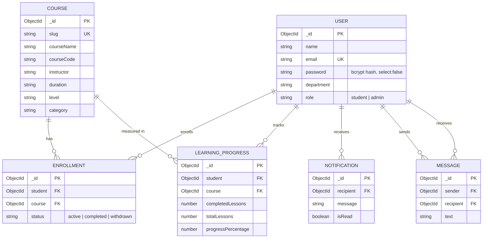

# Database Schema (MongoDB + Mongoose)

Database name: `coursehub` (set by `MONGO_URI`). MongoDB adds a unique `_id` (ObjectId) to every document.

## Relationship diagram

## Collections

| Collection | Required fields | Constraints / indexes |
|---|---|---|
| `users` | name, email, password | `email` unique; `role` student/admin; password `select: false` |
| `courses` | slug, courseName | `slug` unique |
| `enrollments` | student, course | unique compound index `{ student, course }`; status active/completed/withdrawn |
| `learningprogresses` | student, course, totalLessons | unique compound index `{ student, course }` |
| `notifications` | recipient, message | message max 500; index `{ recipient, createdAt: -1 }` |
| `messages` | sender, recipient, text | text max 2000; index `{ sender, recipient, createdAt: -1 }` |